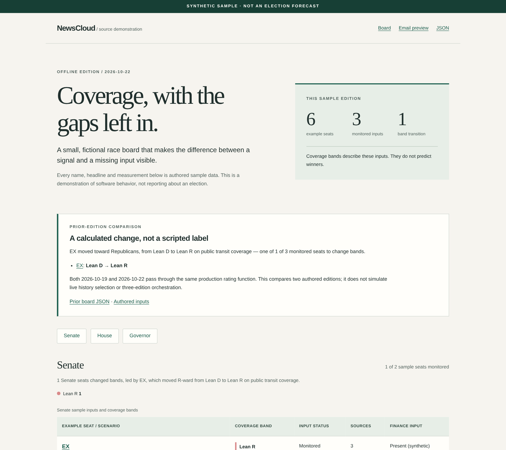
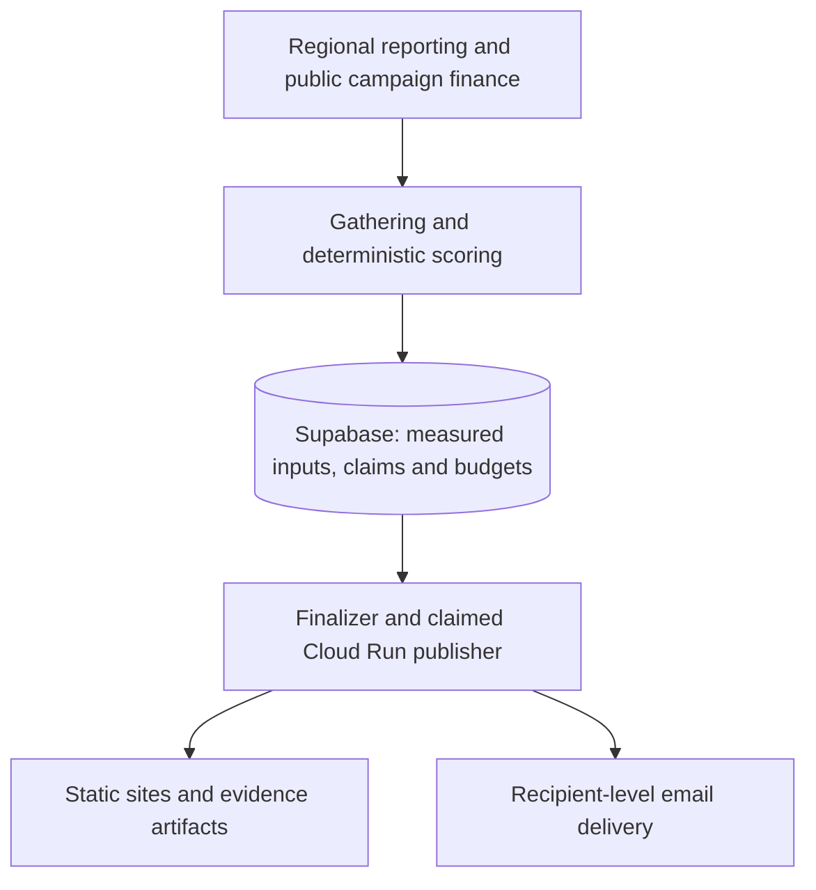

# NewsCloud

**Regional news, traceable evidence, and the engineering required to publish both reliably.**

[](https://github.com/gregory1506/newscloud-portfolio/actions/workflows/verify.yml)

[Run the demo](#run-it-locally) · [Engineering results](#engineering-results) · [Architecture](#architecture) · [Case study](docs/case-study.md) · [MIT license](LICENSE)

I built and operated NewsCloud to turn regional reporting into a recurring view of what outlets were covering, with evidence readers could inspect. It grew from news gathering, word clouds and language scoring into a U.S. **Race Board** combining monitored coverage with public campaign finance, race-detail pages and an email edition.

The regional pipeline covered **53 jurisdictions**: all 50 U.S. states, Washington, D.C., the United Kingdom, and Trinidad & Tobago. The U.S. board represented **509 races**, but representation was not the same as monitoring: races without qualifying inputs had to remain visibly unmonitored. Coverage ratings describe the available inputs; **they are not election forecasts**.

This repository makes the work inspectable: production-derived Python and SQL, an offline demonstration using the real rating/export/rendering functions, and dated case studies of what worked—and what did not.



*The screenshot is an authored, synthetic demonstration—not live reporting or a historical production capture.*

## Engineering results

The strongest results came from fixing operational behavior and data contracts, not adding more features.

| Problem | Change | Recorded result |
|---|---|---|
| Duplicate delivery amplified work: three earlier days recorded **23,648–28,010 gatherer invocations** against roughly 53 expected. | Atomic work claims, bounded redelivery and explicitly paced Cloud Tasks dispatch. | **53–54 HTTP requests for 53 regions** per fan-out in the October 4–7 observation window. [Incident](docs/incidents/retry-amplification.md) |
| Missing inputs inflated the board to **377 apparent tossups**. | Separate numeric fallback from monitoring eligibility; apply that distinction to board tallies, email selection and retrospective calibration. | **27 monitored tossups**, with **156 monitored / 353 unmonitored races**, in the October 9 snapshot. [Incident](docs/incidents/missing-coverage.md) |
| Successful processing could leave publication unfinished when its CI-owned runtime did not execute. | Move publication ownership into a claimed Cloud Run job, with shadow comparison, manifests and output verification. | Active cutover recorded in September, after shadow comparison and deployed-output checks. [Architecture](docs/architecture.md) |

These are dated operator observations, not lifetime service guarantees. The dispatch comparison uses different transport counters, so it is not a controlled performance benchmark. The tally correction measures presentation correctness—not electoral accuracy. “Monitored” can mean qualifying source breadth **or** recorded finance coverage. [Evidence and measurement limits](docs/evidence.md)

## Run it locally

**Python 3.13 or newer. No API keys, database, cloud account or dependency installation needed.**

```bash
git clone https://github.com/gregory1506/newscloud-portfolio.git
cd newscloud-portfolio
python3 -m demo.build --output demo-output
python3 -m http.server 8000 --directory demo-output --bind 127.0.0.1
```

Open **[localhost:8000](http://localhost:8000)**. Stop the server with Ctrl-C. You can also open `demo-output/index.html` directly; serve only the generated directory, not the repository root.

The six fictional races let you inspect:

- **Missing versus thin evidence:** no-input, below-threshold, two-source and finance-only cases do not all receive the same treatment.
- **A calculated change:** authored prior/current editions pass through the same production rating function—not a hard-coded transition label.
- **Evidence and delivery formats:** follow race details to local evidence pages, inspect input/output JSON, and compare HTML with plain-text email.

The demo does not gather news, run cloud orchestration, emulate a database or send messages. It exercises a real, bounded computation-to-presentation path. [Demo contract and development commands](docs/local-demo.md)

## Architecture

**Python · GCP Cloud Functions · Pub/Sub · Cloud Tasks · Cloud Run · PostgreSQL/Supabase · Cloudflare R2 / Pages**



*Production logical flow. Only the rating, export and rendering boundary runs in the offline demo.*

The important design choices are in the ownership rules:

- **Claim before spending.** Database-backed claims reject duplicate work before provider access; durable reservations enforce shared quotas across instances.
- **Reconcile toward a postcondition.** A message acknowledgment or green job is not publication. Expected work, dated artifacts, delivery state and terminal publication status need separate checks.
- **Keep computation inspectable.** Core sentiment, leaning and issue scoring are computed in code rather than generated by an LLM. The retained coverage-band calculator is deterministic, with explicit missing-component and confidence behavior.
- **Expose uncertainty in the interface.** A midpoint fallback is not evidence of a close race. Monitoring eligibility is a separate public contract.

[Detailed architecture and source map](docs/architecture.md) · [Decision record](docs/decisions.md)

## What did not work

**The storage migration was incomplete.** Writes had moved to R2, but quota-bearing originals remained in Supabase. A project-wide restriction then blocked database access and even the cleanup API. Recovery required restoring access, reconciling copies, deleting legacy objects and recovering the interrupted edition. The lesson: a new write destination is not a completed migration. [Postmortem](docs/incidents/storage-quota.md)

**The predictive claim did not earn support.** The event backtest and sensitivity sweep did not establish predictive validity. The controls also had material limitations, so “proven noise” would overstate the negative result. I narrowed the product to descriptive coverage intelligence rather than market the score as an election forecast. [Evaluation](docs/evaluation.md)

**Technical delivery did not establish product-market fit.** Publication, signup and email infrastructure were real; sustained paid demand, retention and customer outcomes were not established in the inspected record. The October snapshot records an every-other-day wind-down, not a commercial scale-up.

## Explore the implementation

| Start here | What to inspect |
|---|---|
| [`shared/coverage_rating.py`](shared/coverage_rating.py) | Deterministic rating, missing inputs, component weights and confidence attenuation |
| [`scripts/export_race_board_data.py`](scripts/export_race_board_data.py) | Monitoring eligibility, public board payloads and sanitized race details |
| [`scripts/generate_board_email.py`](scripts/generate_board_email.py) | Evidence-backed HTML/plain-text email representation |
| [`reference/functions/`](reference/functions/) | Collection, orchestration, reconciliation and operational audits |
| [`reference/supabase/migrations/`](reference/supabase/migrations/) | Durable claims, quota/delivery state and database access boundaries |
| [`reference/jobs/site_publisher/runner.py`](reference/jobs/site_publisher/runner.py) | Publication ownership, sequencing and external side effects |
| [`demo/`](demo/) and [`tests/`](tests/) | Runnable synthetic adapter and behavioral regressions |

**Verification:** the October 26 clean-clone check passed **131 tests with no skips**, generated the demo with Python `-S`, and checked local links and repeatable output. Source provenance is verified against **128 recorded hashes**. These are checks of this public snapshot—not the full private production suite or a scientific validation result. [Verification record](docs/verification.md) · [Current CI](https://github.com/gregory1506/newscloud-portfolio/actions/workflows/verify.yml)

## Project history and my role

Built through iterative development, structured review and production feedback. I led product direction and operational decisions—from addressing reliability issues to narrowing the product when the evidence did not support its original ambition.

The idea dates to **February 2026 in my account**; the earliest verified main-repository commit is **May 1**. The public source snapshot ends on **October 23, 2026**. Its fresh public Git history is a release history, not a reconstruction of earlier commits.

[Project evolution](docs/evolution.md) · [Full case study](docs/case-study.md) · [Dated evidence](docs/evidence.md)

## License and release boundary

Released under the **[MIT License](LICENSE)**. The runnable demo is supported by retained modules in `shared/` and `scripts/`; `reference/` is implementation for inspection, **not a turnkey cloud deployment**.

Production credentials, subscriber records, private research, original Git history, news excerpts and external map assets are excluded. The source manifest records what was exported and adapted; it is not a guarantee that every possible security issue is absent.

[Provenance](PROVENANCE.md) · [Rights and excluded assets](RIGHTS.md) · [Security and private reporting](SECURITY.md)
