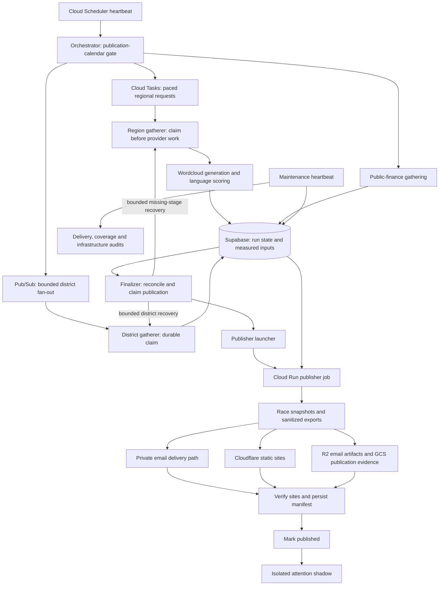

# Architecture: separate computation, ownership and publication

[Case study](case-study.md) · [Local demo](local-demo.md) · [Decisions](decisions.md)

This describes the **October 23, 2026 production-derived snapshot**, not a deployment supported by this repository. The offline demo runs only the rating/export/rendering boundary. Cloud functions, jobs and migrations are retained under `reference/` for inspection; credentials, infrastructure configuration, live datasets and operational scripts are intentionally incomplete as a deployment package.

## Production flow

The diagram is a logical dependency view, not a promise of atomicity across vendors. The publisher code dispatches email before deploying and verifying sites; a later failure can therefore follow an earlier external side effect. Durable delivery identity and reconciliation matter precisely because the whole operation is not one transaction.

## Ownership and invariants

### A message is an attempt, not permission to work

The region and district gatherers claim a dated unit of work in PostgreSQL before spending provider credits. An active or completed claim can reject a duplicate. Retry claims have leases and bounded attempts; stale recovery must distinguish queued work from genuinely missing delivery.

Regional initial dispatch uses Cloud Tasks with scheduled times. Pub/Sub remains for downstream events, district dispatch and regional recovery. A queue's average rate was insufficient because burst behavior still allowed closely spaced requests; explicit task schedule times supplied the regional spacing. In-request provider pacing was retained because a region can make multiple queries and recovery still has a topic path. [Retry incident](incidents/retry-amplification.md)

### Resource budgets belong in durable state

Provider quota reservation distinguishes rolling-window denial from daily exhaustion. Email recipient budgeting uses the same broader principle: shared limits cannot be enforced reliably by independent process-local counters. A denied operation must remain visible; it is not an empty but successful input.

### The database is both data store and coordination store

Run tables record expected work even when its corpus is empty. Claim RPCs control mutation; private tables use row-level-security/revocation boundaries. This coupling makes recovery inspectable, but a project-wide database/API restriction also has a large blast radius. [Storage incident](incidents/storage-quota.md)

### Publication is a terminal state, not an export command

The publisher claims a dated/mode-specific task, assembles race snapshots before exporting them, creates artifacts and immutable evidence, and performs active-mode side effects. `mark_published` occurs after dispatch, deployment, live verification and manifest persistence. Shadow mode separates build comparison from active sends and site deployment.

There are deliberately softer boundaries too: board-email generation catches errors, and the attention shadow is isolated from publication failure. These protect the principal site path but require separate output checks. A completed publisher job alone does not prove every optional product ran. [Evaluation](evaluation.md#three-different-meanings-of-success)

### Off-days do not disable operations

The calendar in [`publication_schedule.py`](../shared/publication_schedule.py) gates new editions. The October 23 change made publication every other calendar day while audits, retries and reconciliation retained their own cadence. Maintenance must select the last scheduled edition rather than treating an intentional off-day as stale output. [E21](evidence.md#e21-october-23-wind-down)

## Rating and evidence semantics

The calculator combines language direction, available public-finance input and incumbency. Missing components are omitted from the active weighted average, while an input-availability confidence factor attenuates the result toward the midpoint. Incumbency alone cannot create an evidenced directional rating. Sentiment/tone does not determine partisan direction. Digital-placement estimates are displayed separately, not used to set the band.

The **presentation eligibility contract is separate from the numeric score**: the exporter marks a race monitored when `source_count >= 2` **or** `fec_coverage > 0`. Thus "monitored" can mean finance coverage, not multiple news outlets. An internally neutral score must not make an unmonitored race appear as a competitive tossup.

[`coverage_quality.py`](../shared/coverage_quality.py) adds corpus and leaning diagnostics. Its assessors return observations; they do **not** independently block publication. A diagnostic threshold, a monitoring flag and statistical validity are three different concepts. Neither the confidence value nor labels such as `Safe` and `Tossup` are calibrated election probabilities. [Missing-coverage incident](incidents/missing-coverage.md)

## Code reading map

| Concern | Retained source |
|---|---|
| Calendar and regional dispatch | [`reference/functions/orchestrator/main.py`](../reference/functions/orchestrator/main.py), [`shared/publication_schedule.py`](../shared/publication_schedule.py) |
| Region and district collection | [`reference/functions/gatherer/`](../reference/functions/gatherer/) |
| Missing-stage recovery | [`reference/functions/finalizer/`](../reference/functions/finalizer/) |
| Atomic retry ownership | [`20260628100000_add_atomic_stage_retry_claims.sql`](../reference/supabase/migrations/20260628100000_add_atomic_stage_retry_claims.sql) |
| Gather deduplication | [`20260928140000_add_region_gather_claim.sql`](../reference/supabase/migrations/20260928140000_add_region_gather_claim.sql), [`20260930120000_add_district_runs.sql`](../reference/supabase/migrations/20260930120000_add_district_runs.sql) |
| Quota and recipient budget | [`shared/newsdata_quota.py`](../shared/newsdata_quota.py), [`shared/email_budget.py`](../shared/email_budget.py), [`reference/supabase/migrations/`](../reference/supabase/migrations/) |
| Publisher ordering and claims | [`reference/jobs/site_publisher/runner.py`](../reference/jobs/site_publisher/runner.py) |
| Infrastructure/delivery audits | [`reference/functions/ops_maintenance/`](../reference/functions/ops_maintenance/), [`reference/scripts/free_tier_report.py`](../reference/scripts/free_tier_report.py) |
| Rating and public contracts | [`shared/coverage_rating.py`](../shared/coverage_rating.py), [`scripts/export_race_board_data.py`](../scripts/export_race_board_data.py) |
| Email representation | [`scripts/generate_board_email.py`](../scripts/generate_board_email.py) |

Reference source may retain imports and runtime contracts whose production dependencies are deliberately not exported. Read it as evidence of design and failure handling, not as an installable cloud application. The [offline demonstration](local-demo.md) is the supported executable path.
