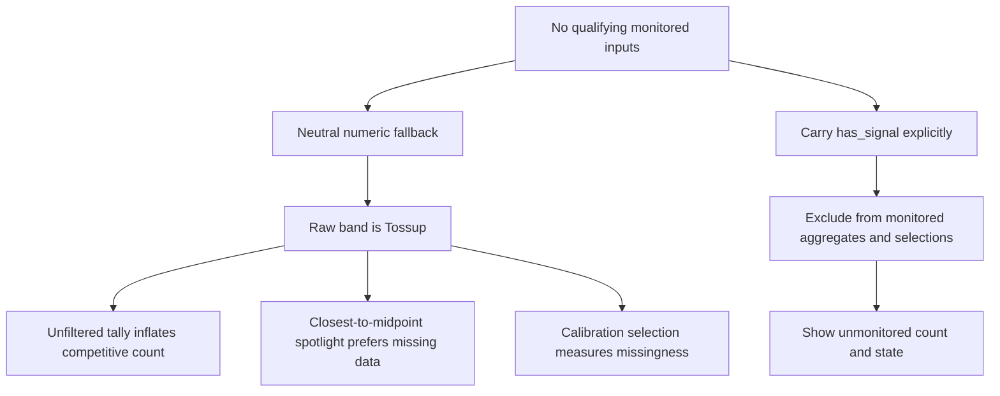

# Incident: missing evidence looked like a competitive race

[Case study](../case-study.md) · [Evaluation](../evaluation.md) · [Evidence E18](../evidence.md#e18-october-9-missing-input-correction)

**Window:** September sourcing investigations and the October 9, 2026 correction. **Impact:** misleading coverage-band totals, spotlight selection and retrospective audit input—not a measured election-forecast error.

## Symptom

The October 9 board snapshot appeared to contain **377 tossups**. Once eligibility was applied, the monitored tossup count was **27**. The same snapshot had qualifying inputs for **156 of 509 races**, with **353 unmonitored**. A visual surface had turned lack of evidence into apparent political competitiveness.

The House was the starkest limitation: **86 of 435 seats** met the monitoring predicate in that snapshot. That predicate includes FEC coverage as an alternative to two sources, so it is not a claim that 86 districts had diverse news reporting.

## Mechanism

The calculator intentionally renormalizes available components and reduces confidence when inputs are missing. With no useful evidence, a value at the neutral midpoint is an unsurprising numeric fallback. But the display band at that midpoint is called `Tossup`.

The error was downstream: consumers treated a valid numeric fallback as an eligible observation.

The same mistake appeared in three places: board totals, email spotlight selection and the retrospective calibration harness's state-level selection. Fixing only the chip color would have left the selection bias intact.

## Correction

- Carry `has_signal` through the public contract and count bands only over monitored races.
- Display unmonitored races and the full denominator separately.
- Exclude missing-input races from closest-tossup email selection and the retrospective calibration map.
- Reject a calibration input missing its eligibility field rather than returning a silently empty result.
- Normalize numeric input types before comparisons; REST-returned numeric strings had exposed a latent failure in the eligibility helper.
- Make the HTML distribution bar reflect the monitored share rather than stretching a thin House footprint to resemble a fully covered chamber.

The retained exporter defines monitoring as **`source_count >= 2` or `fec_coverage > 0`**. It is a product eligibility rule, not an assertion that the evidence is representative, independent or predictive.

## Why more feeds were not enough

The September 25 review had found only **two House races with at least two supporting outlets**, with **23 having any**, across an intentionally bounded district-targeting policy. A subsequent district-feed experiment found that broad statewide material could look sufficiently rich until relevant district filtering left a thin corpus. Reusing the state's coverage would have hidden the shortage rather than solved it. [E12](../evidence.md#e12-house-coverage-limit)

The retained [`coverage_quality.py`](../../shared/coverage_quality.py) makes source breadth and neutral-leaning diagnostics available. Its assessors return observations; they do not independently stop publication. Do not mistake a logged quality warning for an enforced publication gate, or a non-neutral score for valid political information.

## What the result establishes

The October 9 correction establishes that the displayed aggregate stopped treating the snapshot's unmonitored races as tossups. It does **not** establish better electoral prediction, newly acquired district journalism or a broader verified monitoring footprint. The meaningful improvement is semantic: absent evidence is visibly absent.

## Actionable prevention pattern

1. Preserve missingness as structured data; never rely on a midpoint or zero to encode it implicitly.
2. Define eligibility once and pass it through every serializer, aggregate, ranking and selection path.
3. Test no-input, thin-input, finance-only and fully monitored cases. In particular, ensure a no-input item cannot win a “closest” selection.
4. State both the eligible and total denominators in prose and charts. Rendered geometry must agree with the numbers.
5. Inspect HTML and text output separately: equivalent data can still produce materially different claims.
6. Treat a source-quality diagnostic, a product monitoring rule and scientific validity as separate contracts.

## Inspect it offline

[Run the synthetic demo](../local-demo.md) and compare missing, thin and finance-only races. It calls the real [`rate_race`](../../shared/coverage_rating.py), [`build_board_payload` / `public_race_detail`](../../scripts/export_race_board_data.py) and [email renderers](../../scripts/generate_board_email.py). The authored prior/current editions exercise a real band calculation without pretending to reproduce live source collection or the production multi-edition selection history.

**Lesson:** missing data is not a neutral observation. When a label carries real-world meaning, eligibility belongs in the public data contract—not just in the math.
