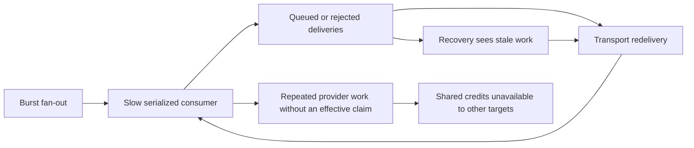

# Incident: retries amplified the work they were meant to recover

[Case study](../case-study.md) · [Architecture](../architecture.md)

**Window:** late September through October 7, 2026. **Evidence:** [E13–E14](../evidence.md#e13-retry-amplification-and-durable-district-state). Historical observations are source-record summaries, not rerun production measurements.

## Symptom and impact

A slow, serialized regional gatherer consumed provider credits while expected district work went missing. Recovery republishes and at-least-once delivery increased attempts rather than completed coverage. The October 9 report records **23,648–28,010 gatherer invocations on three earlier days against roughly 53 expected**. An invocation count is not a count of distinct gathered regions or provider requests.

The failure had two costs: infrastructure churn and a biased coverage footprint. A system that repeatedly services states can starve districts even while claiming substantial activity.

## Failure mechanism

The recovery timeout was shorter than a full serialized sweep. A queued region could therefore look stale before it had a fair chance to run. Unbounded redelivery compounded the burst. Before atomic gather claiming, duplicate deliveries could spend credits again.

The correct response was not simply a larger retry count. It required separating **delivery**, **ownership**, **provider budget** and **completion**.

## Corrections in sequence

1. **Claim before provider work.** A database compare-and-set identifies the delivery permitted to gather a dated region. Active/completed duplicates exit without another provider call.
2. **Bound transport redelivery.** Dead-letter handling limits damage and retains failed work for inspection. The policy must be audited after redeploy because the managed trigger can change its subscription.
3. **Make quota reservation durable.** Shared rolling-window and daily limits distinguish temporary deferral from terminal daily exhaustion.
4. **Represent districts explicitly.** September 30 district-run rows and claims made attempted-empty, never-attempted, deferred and completed work distinguishable and recoverable.
5. **Pace the initial regional dispatch.** Cloud Tasks schedule times space regions rather than expecting a consumer to drain a simultaneous burst. Queue average rate alone was insufficient because its burst behavior still admitted back-to-back work. Per-query pacing remained necessary inside a region and on the Pub/Sub recovery path.

## Recorded outcome—and its limit

Across **October 4–7**, the report records **53–54 HTTP requests for 53 regions** per fan-out, settled median request gaps of **64–65 seconds**, and a drained queue. The **October 3–7** editions published **56–59 minutes after fan-out**. Transition duplicates were recorded separately and claim-skipped.

This is a short-window comparison across different transport counters, not a permanent SLA, a controlled cost experiment or proof that district sourcing was fixed. The district path remained Pub/Sub-based; a completed attempt can still return inadequate evidence.

## Operational response pattern

For a recurrence, inspect these in order rather than immediately replaying the fan-out:

1. Compare **expected dated targets** with durable claims/completions. Separate never-started work from active, deferred and empty work.
2. Compare transport backlog and delivery attempts with provider calls and quota denials. They measure different stages.
3. Check whether recovery timing is shorter than expected queue drain time. Do not classify queued work as lost from age alone.
4. Confirm duplicate rejection occurs **before** provider access and that retry claims preserve the attempt budget.
5. Replay only eligible missing work, with pacing and bounded attempts. Verify durable completion and coverage output, not only acknowledgment.

A stronger acceptance criterion is "each expected target has an explained terminal/deferred state and duplicate attempts do not spend another credit," not "the job is green."

## Inspectable implementation

- [Orchestrator and Cloud Tasks dispatch](../../reference/functions/orchestrator/main.py)
- [Region claim SQL](../../reference/supabase/migrations/20260928140000_add_region_gather_claim.sql)
- [District state and claim SQL](../../reference/supabase/migrations/20260930120000_add_district_runs.sql)
- [Atomic stage-retry claims](../../reference/supabase/migrations/20260628100000_add_atomic_stage_retry_claims.sql)
- [Durable provider quota helper](../../shared/newsdata_quota.py)
- [Finalizer reconciliation](../../reference/functions/finalizer/)

**Lesson:** retries are safe only when the unit of work has an owner, a budget and a completion condition. More delivery attempts are not more coverage.
