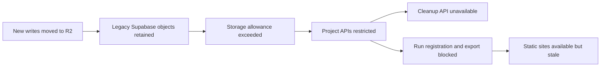

# Incident: moving storage did not retire the old quota

[Case study](../case-study.md) · [Evidence E15–E17](../evidence.md#e15-storage-quota-outage)

**Window:** restriction discovered September 29–30, 2026; follow-up recorded October 7–9. **Status:** access restored and legacy objects removed in the historical record. This release performs no cloud operations.

## Symptom and blast radius

A publication deploy failed while exporting core snapshots. The failure was not the new page styling: Supabase returned **HTTP 402** for a project-wide storage restriction. Both data and storage APIs were unavailable. The static sites still served their previous edition, making the outage a freshness failure rather than a total website disappearance.

The September 30 record attributes the restriction to **6,841 retained objects, about 1.13 GB against a 1 GB Storage allowance**. Production writes had moved to R2 in August, but the quota-bearing originals remained. Because every pipeline stage depended on the restricted project, even creating the day's run record failed.

## Why the migration was incomplete

The migration had achieved a write-path cutover, not full retirement. Reconciliation and read-fallback gates were already understood, but deletion had not happened. The provider's enforcement boundary was wider than the storage feature: exceeding one quota blocked unrelated database access and the very API needed to remove the objects.

## Recovery actually recorded

1. **Restore authorized access.** The owner upgraded the organization, lifting the restriction. Cleanup could not bypass a blocked storage API.
2. **Reconfirm the deletion gate.** All **6,841 objects** had equal-size copies in R2. This was the recorded reconciliation criterion, not a claim of cryptographic comparison for every object.
3. **Delete in bounded batches.** The record reports zero deletion failures and **zero remaining objects and bytes**.
4. **Finish the cutover.** Remove the obsolete Supabase read fallback rather than silently retrieving an old duplicate when R2 lacked an object. Confirm production object writers use R2.
5. **Recover the interrupted edition.** Restarted work encountered a separate burst-delivery problem and needed paced recovery. The September 30 publication was recorded at **20:14 UTC**, roughly **4 hours 15 minutes after the scheduled run**, not immediately after API access returned.
6. **Check the steady state.** October 7–9 follow-up again recorded empty legacy storage. The usage reporter was extended to measure storage objects/bytes and database size, with unavailable measurements reported explicitly.

The outage was resolved in the record; that does not make the original delay acceptable or prove the system thereafter stayed within every vendor's free allowance. Image and secret footprints still had structural overages.

## The adjacent “silent success” trap

The October 2 image-pruning audit found another cleanup postcondition failure: **40 accepted operations** had been counted as deletions even though the operations failed on tagged versions. The correction waited for terminal success, retained failures and handled tag-deletion propagation. Lagging storage-byte metrics and concurrent deploys meant deletion counts could not immediately substantiate a billed-savings claim. [E17](../evidence.md#e17-silent-pruning-success)

Both failures share a pattern: *a migration command ran* or *an API accepted work* is weaker than *the old resource no longer exists and can no longer refill*.

## Actionable migration checklist

For a similar migration, define these exit conditions before declaring it complete:

- Inventory old objects and verify the destination with an explicitly named reconciliation strength.
- Identify every reader and writer, including artifact-generation jobs outside the obvious storage service.
- Exercise destination reads, including missing-object failure; do not let fallback hide an incomplete cutover indefinitely.
- Confirm source deletion is actually authorized and possible before enforcement blocks the API.
- Count terminal deletion successes and failures; poll long-running operations instead of equating acceptance with completion.
- Verify source object count/bytes after cleanup and again after normal production writes.
- Audit project-wide restrictions separately from service-specific quotas; report unknown usage as unknown, not zero.
- Verify the recovered edition's date and delivery state. Restored API access alone is not restored product service.

## Inspectable implementation

- [R2 object-store helper](../../scripts/r2_object_store.py)
- [Email artifact generation/storage boundary](../../scripts/generate_board_email.py)
- [Usage reporter](../../reference/scripts/free_tier_report.py)
- [Maintenance audits](../../reference/functions/ops_maintenance/)

The destructive cleanup/pruning scripts, account identifiers and original objects are intentionally not exported. The incident's aggregates stand on the dated evidence notes, not on a dangerous "try the recovery" command.

**Lesson:** a migration is complete when ownership, reads, writes, retention and quota accounting all agree—not when the new destination first receives data.
