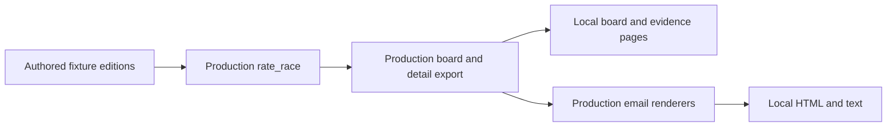

# Run the offline demonstration

[Project introduction](../README.md) · [Architecture](architecture.md)

## Requirements and commands

Use Python 3.13 or newer from the repository root. The demo uses the Python standard library and retained project modules; no dependency installation, API key, cloud account, database or runtime download is required.

```bash
python3 -m demo.build --output demo-output
```

Open `demo-output/index.html` directly, or serve the generated directory only:

```bash
python3 -m http.server 8000 --directory demo-output --bind 127.0.0.1
```

Visit [localhost:8000](http://localhost:8000). Stop serving with Ctrl-C. Use another output directory with `--output path/to/directory` if desired. Do not serve the repository root: the generated output is the intended reading surface.

Use an empty directory for a first build. Rebuilds require the demo's ownership marker and reject symlinks, unrelated files and protected source paths before writing. The builder does not delete foreign files; choose a new empty directory rather than mixing generated output with personal material.

## What to inspect

1. **Board:** compare monitored and unmonitored counts. A neutral internal score must not turn absent inputs into a competitive-looking coverage tally.
2. **Race details:** follow a local detail link to see the inputs, rating components and supporting synthetic evidence.
3. **Changed band:** inspect the authored prior and current editions, **October 19 and October 22, 2026**. Both are rated by the real calculator. These are fixed fixture dates, not historical production observations; the comparison does not reproduce production's multi-edition history-selection policy.
4. **Email:** read both HTML and text. They are rendered by the retained production functions, with local navigation and synthetic disclosures for this demo.
5. **Machine-readable artifacts:** compare input fixtures and board outputs without reverse-engineering the HTML.

The examples use fictional jurisdictions `EX` and `QZ` and **six authored races** across Senate, House and governor categories. They include qualifying monitored coverage, thin two-source coverage without money or known incumbency, a below-threshold single-source case, no-input coverage and finance-only monitoring. The fixture counts describe the demonstration, not real races or service reach.

## Output map

| Artifact | Purpose |
|---|---|
| `index.html` | Local board and navigation |
| `email.html`, `email.txt` | HTML and plain-text editions |
| `board.json`, `prior-board.json` | Public board payloads for both fixture editions |
| `fixtures.json` | Authored inputs and fixed dates |
| `race/<slug>/index.html` | Local race explanation |
| `race/<slug>/detail.json` | Public detail payload plus `demo.calculations.current/prior`, with actual components, weights, confidence and authored inputs |
| `evidence/<id>.html` | Authored synthetic evidence, not copied journalism |
| `style.css`, `favicon.svg` | Authored local presentation and site icon |
| `.newscloud-demo-output` | Ownership marker permitting a safe repeat build |

## The real implementation boundary

The build calls:

- [`rate_race`](../shared/coverage_rating.py) for deterministic rating math;
- [`build_board_payload` and `public_race_detail`](../scripts/export_race_board_data.py) for public board/detail shaping and monitoring eligibility;
- the HTML/text renderers in [`generate_board_email.py`](../scripts/generate_board_email.py).

The demo adapts local links and supplies synthetic inputs. It does not replace the rating with an independently reimplemented formula. Storage and network helpers may exist in retained modules, but the demo does not invoke those paths.



## What a successful build would—and would not—show

A build demonstrates that these fixture inputs can pass through the retained calculator, public serializers and email renderers. It does **not** establish news-source freshness, scorer accuracy, successful ingestion, database concurrency, cloud authentication, quota enforcement, delivery, forecasting or customer value. Those are different systems and require different evidence.

No real news excerpts, recipients, election results or external maps are needed. The demonstration sends nothing and deploys nothing. Its confidence values describe the calculator's input-availability heuristic, not a statistical probability.

Candidate verification is separate from the historical source test record. See [evaluation](evaluation.md) for dated observations; the source's larger suite and coverage report do not describe this candidate.

## Development checks

Only the tests need third-party packages. In a dedicated virtual environment:

```bash
python3 -m venv .venv
.venv/bin/python -m pip install --requirement requirements-dev.txt
.venv/bin/python tools/verify_candidate.py
PYTEST_DISABLE_PLUGIN_AUTOLOAD=1 .venv/bin/python -m pytest -q
```

`verify_candidate.py` checks recorded export hashes, the production-derived file allowlist, local documentation paths and basic contact/key-file hygiene. It is not a substitute for the separate secret scan and manual privacy review in [SECURITY.md](../SECURITY.md). Changes to exported source require corresponding provenance/manifest updates; newly authored files in a protected source root require an explicit verifier exception.

The small test lock is generated from `requirements-dev.in` with `uv pip compile requirements-dev.in --python-version 3.13 --universal --no-annotate --no-header --output-file requirements-dev.txt`. No test dependency is imported by the documented demo command.
