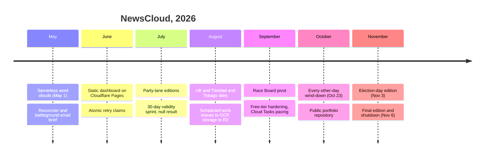
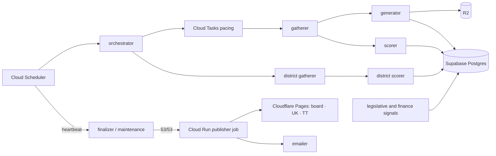

# NewsCloud retrospective, May 1 – November 6, 2026

[README](../README.md) · [Case study](case-study.md) · [Evidence](evidence.md#e25-lifetime-totals-at-shutdown)

NewsCloud ran for six months. It started as a serverless word-cloud pipeline for regional news and ended as the **Race Board**, a single-page view of the 2026 U.S. midterms built from monitored coverage and public campaign finance. Its last edition published on **November 6, 2026**, three days after the election. Production was then shut down: deploy workflows and schedulers stopped, then every function, job and topic deleted. The data store and the final static sites stay up as the record.

The general-audience send-off, with results and the board-versus-outcome comparison, is live at **[newscloud-dashboard.pages.dev/farewell/](https://newscloud-dashboard.pages.dev/farewell/)**; the final board is archived at [newscloud-dashboard.pages.dev/board/](https://newscloud-dashboard.pages.dev/board/). This page is for engineers.

The public source snapshot in this repository still ends on October 23 (`71070bb`). The figures below come from the private production record read on November 6; they are operator records, not independently rerun measurements. [E25–E27](evidence.md#e25-lifetime-totals-at-shutdown)

## By the numbers

Read from the production database and source repository on November 6, 2026.

| Metric | Value |
|---|---|
| Lifetime | 2026-05-01 → 2026-11-06 |
| Pipeline runs | 182 run records; 151 published; none recorded as failed |
| Regions per run | 53: 50 states, D.C., the United Kingdom, Trinidad & Tobago |
| Region-days processed | 9,469 |
| Source pulls | 48,653 from 366 distinct sources |
| Raw feed/API items | 1,364,869 (not deduplicated across days) |
| Word clouds rendered | 9,588 |
| Races on the board | 509: 435 House, 35 Senate, 39 governor |
| Daily race snapshots | 21,887 across 43 board editions (September 17 → November 6) |
| Emails sent | ~1,180 handed to the email provider (handoff, not confirmed inbox delivery) |
| Private source repository | 783 commits · 1,102 tests · 35 migrations |

“None recorded as failed” is a status count: runs that never published (for example the lost September editions and October 29, below) were not all marked failed. These totals describe activity, not readership, accuracy or commercial demand.

## Timeline

1. **Serverless word clouds (May 1–4).** The first commit already covered the U.S., the U.K. and Trinidad & Tobago. Within days it ran on Cloud Functions Gen 2 with Pub/Sub triggers, managed secrets, Supabase writes, a scheduler and alerting. Deterministic sentiment and political-leaning scorers followed.
2. **Reconciler and email brief (May).** Count-based fan-in was replaced by per-region state in Postgres, so a run publishes only at 53/53 and retries only the missing stage. A battleground email brief shipped on a transactional email provider.
3. **Dashboards (May – June).** A static site reads dated JSON exports from a CDN. There are no live database reads, so hosting stays free and publishing is a build step.
4. **Party-lane editions (June – September).** Two party-framed products sat on a single shared fact layer, adding legislative signals, independent expenditures and political-ad spend. A 30-day validity sprint then tested whether the leaning signal led outcomes. **All 10 quiet-state negative controls were false positives**, and no tested parameter setting fixed that. The result was recorded, not tuned away. [Evaluation](evaluation.md)
5. **Regional sites (August – September).** The U.K. and Trinidad & Tobago got their own static sites. Political leaning was dropped there because a U.S. lexicon scored *Labour* as left-wing copy.
6. **Leaving CI-hosted runtime, moving storage (late August – September).** CI runners stopped when their budget ran out, so scheduled work moved to GCP. Publication moved to a Cloud Run job after a shadow run produced identical sites. Object storage moved to Cloudflare R2; the database stayed on Supabase. [Architecture](architecture.md)
7. **Race Board (September 19–24).** The party lanes were replaced by one board of 509 races. Each race gets a **Coverage Rating band** computed from coverage tilt, campaign finance and incumbency. Bands describe coverage and are not win probabilities. Retired subsystems were deleted, not frozen, along with their tests.
8. **Free-tier hardening (late September – October 9).** Budget alerting, atomic provider-credit reservation, pooled email budgets, dead-letter topics, bounded redelivery, scale-to-zero and Cloud Tasks pacing. [Retry incident](incidents/retry-amplification.md)
9. **Wind-down (October 23 – November 6).** Publication dropped to every other day, with a one-off election-day edition on November 3. The final edition went out on November 6, followed by shutdown.

## Architecture at shutdown

At shutdown the fleet was 14 Gen 2 functions, one Cloud Run job, 10 Pub/Sub topics with bounded delivery attempts and a dead-letter topic, one Cloud Tasks queue and three Cloud Scheduler jobs. CI/CD built and deployed through keyless workload identity: path-filtered per-function deploys, gated on tests and serialized. The [reference source](../reference/) is the October 23 snapshot of this system, not a turnkey deployment.

## Decisions that held up

| Decision | Rejected alternative |
|---|---|
| Static JSON on a CDN; no live database reads | A database-backed app with auth and an API |
| Per-region reconciler state in Postgres | Counting completion events |
| Atomic retry claims via a database function | Read-then-write timestamps, which caused duplicate retries |
| Deterministic scores; LLMs only in bounded, structured roles | Model-generated scoring |
| Descriptive Coverage Rating bands | A predicted verdict: the backtest found no lead, so a probability would have been manufactured credibility |
| Accept the null validity result | Adding a false-positive threshold after seeing the results |
| “No data” renders gray, not Tossup | Zero-filling, which once painted most House seats as tossups |
| Move object storage, keep the database | A full database migration |
| GCP owns runtime; CI only builds and deploys | Raising the CI budget |
| Cloud Tasks pacing via each task's scheduled time | Trusting the queue rate limit alone |
| Delete retired subsystems | Keeping frozen code and dormant permissions |

More detail: [decision record](decisions.md).

## What went wrong

- **A lint refactor took the gatherer down (September 17–19).** Clearing complexity findings moved an event-handler decorator onto a helper. Two editions were lost for good because the messages outlived Pub/Sub retention, and the finalizer did not alert on 0/53.
- **Supabase restricted the whole project (September 30).** Legacy storage left behind after the R2 migration exceeded the quota; the restriction then blocked the API needed to delete it. [Postmortem](incidents/storage-quota.md)
- **Redelivery amplification.** Duplicate deliveries each spent provider credits until the account was exhausted. [Incident](incidents/retry-amplification.md)
- **Silent failures.** An image-registry prune counted accepted operations as deletions; a manual monitoring gate lapsed for days unnoticed; a test exit code was masked by a pipe.
- **The core signal was never validated, and no buyer was found.** Customer discovery never started in earnest. Board coverage stayed thin: most races remained unmonitored to the end.
- **The October 29 edition never published.** The cause was an immutable-snapshot conflict, and it was not investigated before shutdown.

## Outcome: the board versus the results

Per-race comparison of the final board against AP race calls as of **November 6, 2026, 18:36 UTC** (unofficial counts). [E26](evidence.md#e26-board-versus-unofficial-results)

- **164** monitored races were scored in total, including tossups.
- **145** monitored races had a leaning band and a called Democratic or Republican winner. The band's side matched the winner in **104 (72%)**.
- A naive “the seat-holder keeps it” rule on the same 145 races matched **101 (70%)**.
- Of **50** monitored seats that flipped, **23** leaned toward the eventual winner, **9** were Tossup and **18** leaned the wrong way.

**This is not a forecast scorecard.** Coverage Rating bands are descriptive coverage signals, not predictions. The two-point margin over the seat-holder baseline is small, on a non-random subset of races (those with enough monitored inputs), against unofficial results. The July validity sprint found 10/10 negative-control false positives; nothing here overturns that.

## Lessons

1. Retries must be claims, not reads.
2. Optional channels such as email must never gate core publication.
3. Free tiers fail as a **whole-project** lockout, not graceful degradation. Clean up as soon as a migration ends.
4. Bounded redelivery and dead letters go on every subscription from day one.
5. Write the null result down next to the analysis and never retro-fit thresholds.
6. A board that says “no data” is more honest, and more useful, than one that says “close”.
7. Delete retired subsystems outright; tests that only guard code no one runs are cost, not safety.

## Shutdown record

On November 6, 2026, production deploy workflows were disabled; the 3 scheduler jobs, the task queue, the Cloud Run job, all 14 functions, 10 Pub/Sub topics, both container-image repositories and 9 alert policies were deleted. Kept: the Supabase database (the record), R2 buckets, publication snapshots, secrets, and the Cloudflare Pages archive sites — the [board](https://newscloud-dashboard.pages.dev/board/), [Trinidad & Tobago](https://newscloud-tt.pages.dev/) and [United Kingdom](https://newscloud-uk.pages.dev/) — each page carrying an “Archived” banner. Signup was retired. A farewell email went to the 7 remaining subscribers; the list is scheduled for deletion on December 7, 2026. [E27](evidence.md#e27-shutdown-record)
